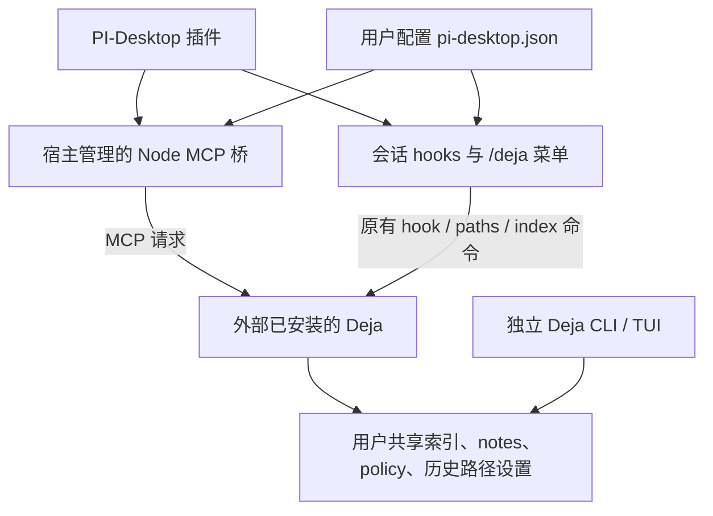

# Deja-vu 的 PI-Desktop 插件（开发基线 0.1.1）

源码属于 Deja-vu 仓库的 **`pi-desktop-plugin/`**，与 `codex-plugin/` 等接入并列维护。它复用已安装的 Deja，通过 MCP 提供主动查询，通过 Agent 扩展提供自动 hooks。**包内没有 Deja EXE、不建立另一套私有记忆、不修改 PI-Desktop 核心。**

## 你需要准备什么？

- PI-Desktop 支持本地插件、`agentExtensions` 和 `mcpServers`。
- Node.js 22 或以上，且桌面应用能通过 PATH 找到 `node`。它只运行轻量 MCP 桥；不是另一份记忆引擎。
- 已安装的原生 Deja 程序。自动查找 PATH 和常见用户工具目录；也可在插件菜单选择绝对路径。无需源码仓库或构建目录。
- 读取 PI-Desktop、Cursor 等数据库数据源需要可通过 PATH 找到的 `sqlite3`。
- 完整 Desktop 索引、历史路径设置、压缩捕获需要支持 `pi-desktop` 数据源及 `paths` 命令的 Deja。本仓库本地适配版具备这些能力；不要默认官方旧发布版已包含它们。

插件不会替你安装 Deja、Node.js 或 sqlite3，不会复制、升级或移动已有程序。尚未准备好依赖时，先安装插件也可以，`/deja` 会给出配置诊断；缺少 Node 时宿主 MCP 桥无法启动，但 Agent 配置命令仍可用。

## 安装后怎么用？

1. 在 PI-Desktop 插件页导入本轮 `.piplug`，替换旧的 `local.deja-vu`。确认权限 `agent.extension` 和 `mcp.server.local`。本轮是基于 `0.1.1` 的开发交付，包名版本未当作正式发布升级。
2. 开一个新聊天，输入 **`/deja`**，选择“设置外部 Deja 程序”。若已自动找到，直接选择“查看状态”。
3. `/deja` → **查看状态**：核对外部程序、版本、sqlite3、索引/notes/policy 位置，以及 PI-Desktop 有效历史路径。检查不解析会话正文、不更新索引。
4. `/deja` → **管理 Agent 历史路径**：选择 Agent 和字段，保存路径或启用状态。检查源文件只枚举文件；保存不更新索引。
5. 准备允许读取真实历史时，`/deja` → **更新索引**，阅读范围提示并确认。它读取当前启用范围内所有数据源，不只是 PI-Desktop。
6. 对 Agent 说：“查 Deja 历史，找以前处理过的这个问题，先给来源再回答。”模型经 ToolSearch 加载 `deja` 工具后调用。工具有 `recall/context/blame/fix/how/orient/remember/handoff` 八个模式。

**自动索引默认关闭。** 你可以在 `/deja` 中明确开启；开启后，会话开始及 Agent 结束时允许刷新，仍遵循共享策略和手动索引覆盖。默认 MCP/hooks 只查询已有索引，并设置 `DEJA_NO_AUTO_INDEX=1`、`DEJA_HOOK_REFRESH=1`，不会产生脱离管理的后台索引子进程。明确执行“更新索引”和 `remember` 等写操作不受“自动关闭”替代。

不要同时再手动配置一份 Deja MCP，否则可能出现重复工具；当前宿主没有插件 MCP 与全局 MCP 的自动去重保证。

## `/deja` 菜单

| 入口 | 作用 | 副作用 |
|---|---|---|
| 查看状态，或 `/deja status` | 程序、版本、有效路径、依赖和索引元数据状态 | 不读会话正文、不索引 |
| 设置外部 Deja 程序 | 选择已安装程序，明确确认后运行 `version` 验证 | 保存选择；不复制程序 |
| 管理 Agent 历史路径 | 编辑字段、检查发现、启用/禁用 Agent | 写共享路径配置；不索引、不删源 |
| 设置共享数据位置 | 索引、notes、policy、源路径配置、XDG config | 只保存路径；不迁移、合并或重建 |
| 更新索引 | 明确确认后执行 `deja index --quiet` | 读启用的历史并更新共享索引 |
| 设置自动索引 | 默认关闭；开启需确认 | 保存本身不执行索引 |

## 一份程序，一份用户数据



MCP 桥只转发公开 `deja` 工具，不实现检索、排序或记忆存储。调用需填写 `cwd`（当前聊天项目绝对路径，不能是插件目录），桥以它启动外部 MCP，避免笔记归到插件目录；`project` 可另作显式筛选或归档。手动确认的索引不设两分钟硬超时，仍可由停止/取消终止。每次调用启动外部 `deja mcp`，预算 25 秒，最大四个并发请求；配置更改下一次调用生效，不用重打包。宿主退出、取消或超时会终止桥管理的子进程树。

hooks 与 MCP 使用同一个运行时配置解析器。默认与独立 Deja 使用相同平台路径：

- 索引目录：`~/.cache/deja/index.db`（是目录，不是 SQLite 文件）。
- notes：Windows `%APPDATA%/deja/notes.jsonl`；Unix `~/.local/share/deja/notes.jsonl`。
- policy：`~/.config/deja/policy.json`。
- Agent 路径：`~/.config/deja/source-paths.json`，由 Deja `paths` 管理，CLI、TUI、插件可共享。

若独立 CLI 用自定义环境覆盖，需在 `/deja` →“设置共享数据位置”选择同一位置；其他已知源/隐私覆盖可保存在下述 `environment` 中。**不会猜测一个终端的环境，也不会宣称 GUI 必然继承终端配置。** 不创建或迁移私有记忆。

## 插件配置

默认位于 `~/.config/deja/pi-desktop.json`，不是插件安装目录；升级包不会覆盖它。内容不含会话正文。`/deja` 会持久化它；也可明确编辑：

```json
{
  "version": 1,
  "executable": "D:\\Tools\\deja\\deja.exe",
  "autoIndex": false,
  "environment": {}
}
```

- `executable` 留空自动查找，不支持 shell 参数或 `.cmd` 脚本；Windows 选择原生 `deja.exe`。
- `environment` 只接受本地路径/数据源/隐私白名单，拒绝 embedding 密钥、Postgres DSN 和未知变量。数据位置必须是绝对路径。
- MCP 与 hooks 不分别继承环境中的 `DEJA_*`、XDG 变量，避免 GUI 与 Agent 进程指向不同数据；请在持久配置中明确设置需要的覆盖。程序发现使用 PATH，子进程不继承模型服务商密钥。
- 可用 `DEJA_PI_CONFIG_FILE` 指定另一份绝对配置路径（主要用于隔离测试；若用于部署须保证宿主与 Agent 环境相同）。
- 格式损坏时不覆盖、不回退到另一份历史；错误包含配置位置，修复该文件后再调用。
- 保存使用短时独占 `.lock` 与原子替换。若上次进程异常退出留下锁，先确认没有写入进程再处理，不自动删除他人锁。

PI-Desktop 历史根仍由 Deja 的共享源设置和迁移发现决定，不在包中固定。当前机器迁移后的根是 `D:\Pi-Desktop-Cache\data`，菜单中应显示这个有效路径；不要将旧 C 盘目录和迁移备份一起索引。

## 自动能力与限制

- 每轮前将有预算、标为不可信历史证据的片段追加到现有系统提示；策略、路径或插件配置改变会撤销本地旧缓存。已发送给模型的内容不会被删除。
- Read/Edit/Write 结果可附文件历史；失败命令结果可附历史修复提示。保留原结果和错误元数据；不自动执行建议命令。
- 压缩前捕获仅限普通 Desktop 会话，拒绝超过 4 MiB 的源文件，子请求预算 2.5 秒；不是完整上下文备份。数据源普通索引上限 64 MiB。原生 pi 续接会话由其自己的生命周期负责，本插件跳过。
- 历史返回给云模型时会随宿主请求进入服务商；本地检索不等于永不出机。脱敏不是完整秘密识别。
- 权限、模式、策略及数据源启用状态仍生效；旧版本 Deja 缺少 Desktop 能力时诊断报出，不宣称已支持。

## 开发与组装

在 **Deja-vu 仓库的 `pi-desktop-plugin` 目录**运行：

```powershell
npm test
# 可选：真实引擎回归，测试只用合成数据与临时路径
$env:DEJA_TEST_BINARY = 'D:\Tools\deja\deja.exe'
npm test
# 只复制插件源码到全新目录，不复制引擎、不嵌入个人路径
node scripts/stage.mjs 'D:\Builds\pi-desktop-deja-plugin'
```

使用 PI 官方 `PluginCheck` 和 `PluginPack` 校验/打包 staging 目录，不用普通压缩命令制作 `.piplug`。源码模板已可组装，不存在 `UNCONFIGURED` 路径或每台机器运行 configure 的要求。用户无需运行源码的任何构建脚本。

版本维持开发基线，不自动发布、推送、安装或重启应用。当前测试、产物与应用内验收边界统一见 [VERIFICATION.md](VERIFICATION.md)。
